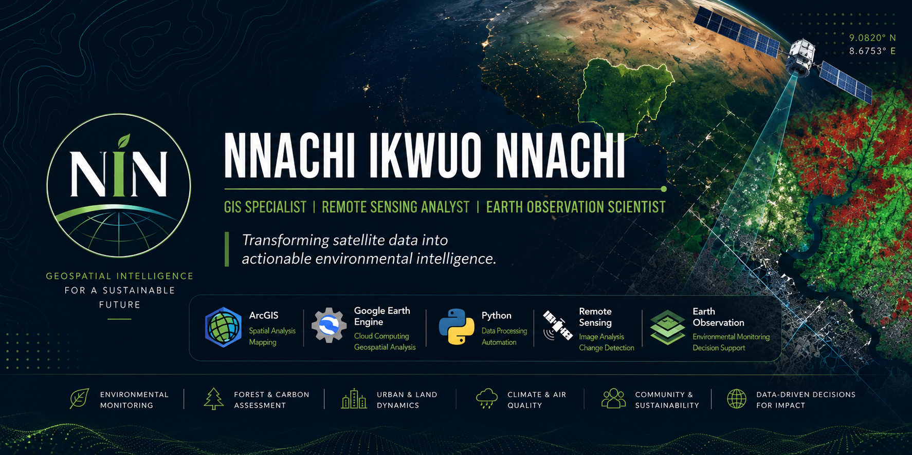

  

<h1 align="center">🌍 Geospatial Portfolio</h1>

  <b>GIS Specialist • Remote Sensing Analyst • Earth Observation Researcher</b> 
  Transforming satellite data into actionable environmental intelligence.

  
  
  
  

---

# 🌍 Overview

This repository showcases my work in **Geographic Information Systems (GIS)**, **Remote Sensing**, **Earth Observation**, **Climate Analytics**, **Environmental Modelling**, and **Spatial Data Science**. It includes research projects, geospatial applications, publications, interactive dashboards, and open-source tools for environmental monitoring and decision support.

---

# 👨‍💼 About Me

I am **Nnachi Ikwuo Nnachi**, a GIS Specialist, Remote Sensing Analyst, and Earth Observation Researcher with over five years of experience applying geospatial technologies to climate change, forest monitoring, urban dynamics, air quality assessment, and sustainable environmental management.

---

# 🛰 Technical Expertise

### GIS & Mapping

### Earth Observation & Datasets

### Programming & Tools

### Research Areas

---

# 🚀 Featured Projects

- 🇳🇬 **Nigeria Climate Dashboard** *(In Development)*
- 🌳 **National Forest Carbon Assessment**
- 🔥 **Urban Heat Dynamics of Enugu State**
- 🌫 **PM₂.₅ & PM₁₀ Modelling for Abuja**
- 🌲 **Okwangwo Forest Dynamics**
- 🌍 **Iran–Israel Environmental Impact Assessment**

---

# 📚 Selected Publications

- **Urban Expansion and Landscape Transformation in Lokoja Metropolis** *(Biosphere, 2026)*
- **Forest Cover Dynamics and Socio-Ecological Drivers in Okwangwo Division** *(Journal of Sustainable Forestry, 2026)*
- **Integrating Traditional Ecological Knowledge into Forest Governance** *(Environmental Policy and Governance, 2026)*
- **Geospatial Assessment of Forest Carbon Dynamics in Nigeria** *(Kaduna Journal of Geography, 2025)*
- **Forest Resilience and Community Adaptation in Okwangwo** *(Alvan Journal of Social Sciences, 2025)*

---

# 🔬 Current Research

- Nigeria Climate Dashboard
- Urban Heat Dynamics of Enugu State
- PM₂.₅ & PM₁₀ Modelling
- Forest Carbon Dynamics
- Climate Adaptation Strategies
- Iran–Israel Environmental Impact Assessment

---

# 📫 Let's Connect

- 📧 **Email**: [nnachiikwuo@gmail.com](mailto:nnachiikwuo@gmail.com)
- 💼 **LinkedIn**: [linkedin.com/in/nnachi-nnachi-016390114](https://www.linkedin.com/in/nnachi-nnachi-016390114/)
- 🎓 **Google Scholar**: [Profile](https://scholar.google.com/citations?user=aV0_MHkAAAAJ&hl=en)
- 🆔 **ORCID**: [0000-0002-3455-3450](https://orcid.org/0000-0002-3455-3450)

---

  <b>Using geospatial intelligence to understand our changing planet.</b>

